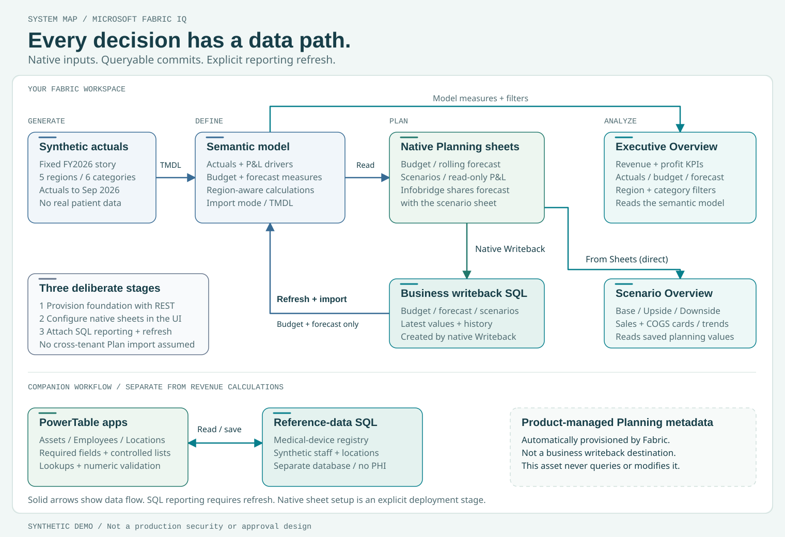

# MedTech Planning in Microsoft Fabric IQ

[](https://github.com/anuraagr/fabric-iq-medtech-planning-demo/actions/workflows/ci.yml)

A reusable **Solution Engineer demo asset** for native Planning in Microsoft Fabric IQ.
Show a fictional MedTech company move from historical actuals to a budget, rolling forecast,
alternative scenarios, SQL writeback, and executive analysis. A companion PowerTable workflow
manages a medical-device registry.

**Synthetic data only. No patients, real customers, credentials, or originating-tenant deployment state.**
The story is deliberately fixed to **FY2026**, with actuals through September 2026, so examples remain reproducible.

> **Deployment boundary:** Python automates the Fabric foundation and the reporting connection.
> The nine native sheets, input actions, and Writeback require the documented **native UI stage**.
> This is not a one-click importer of another tenant's Plan, and it does not replace Planning with a custom app.



[Architecture breakdown](docs/architecture.md) · [PNG](docs/images/architecture.png) · [Editable Excalidraw source](docs/images/architecture.excalidraw)

## What has been built

| Component | Demonstration | Deployment |
|---|---|---|
| Dedicated Fabric workspace | Tenant-isolated demo resources on your selected existing capacity | REST |
| Two business SQL databases | Planning writeback and separate PowerTable reference data | REST; native UI creates the business tables |
| MedTech semantic model | Deterministic actuals, product/date/geography, P&L drivers, shared measures; 26,970 sales rows | Generated TMDL + REST |
| Official FMCG baseline | The pinned Microsoft sample semantic model and an empty tutorial Plan item | Verified download + Power BI/Fabric REST |
| **FY2026 Revenue Budget** | A 268M top-down target; a 250K bottom-up adjustment; ancestor roll-up | Native Planning UI |
| **Rolling Forecast** | Closed-period actuals, seasonal forecasting, open-period input and forecast writeback | Native Planning UI |
| **Scenario Comparison** | Base / Upside / Downside; sales and COGS drivers; gross-profit comparison | Native Planning UI |
| **Profitability P&L** | Gross-to-net revenue, COGS, operating expenses and operating profit | Native Planning UI; read-only actuals view |
| **Assets / Employees / Locations** | Three PowerTable apps: required fields, controlled lists, lookups, bounds, insert and update | Native PowerTable UI |
| **Executive Overview** | Revenue/profit cards, actual-vs-budget, forecast-vs-budget, trends, geography/product filters | Native Intelligence UI; semantic-model data |
| **Scenario Overview** | Scenario sales/COGS cards and monthly comparisons | Native Intelligence UI; **From Sheets** data |
| Infobridge | Forecast measure shared from Rolling Forecast into Scenario Comparison | Native UI query; no custom ETL |
| Reporting round trip | Latest leaf-level SQL budget/forecast values imported into the model after a refresh | Explicit post-writeback deployment stage |
| Verification and operations | SQL/DAX checks, snapshots/diffs, refresh, permissions probes, guarded reset/cleanup | Python CLI |

The P&L is not an editable financial-statement plan. PowerTable is not connected to revenue calculations.
Scenario gross-profit commentary is static text; its sales/COGS charts are data-bound.
See [reference evidence and limitations](docs/deployment-status.md) rather than treating screenshots as proof of your deployment.

## Deploy in your own tenant

### 1. Prerequisites

- Python **3.11 or 3.13**, Git, Azure CLI and **ODBC Driver 18 for SQL Server**.
- Microsoft Edge or Chrome for native UI configuration. The optional Playwright helpers are Windows/Edge-specific.
- A **native member** of the target Entra tenant, with the required Fabric permissions. Guest access is not assumed.
- An existing **active, Planning-capable Fabric/Premium capacity**, required XMLA settings, and sufficient memory/CUs.
  The original small shared trial throttled under bursts; SKU family alone is not a sizing guarantee.
- Capacity-owner approval for the demo's consumption. Opening a plan can start a non-cancellable 30-day Planning session.

[Prerequisites and security](docs/security-and-permissions.md) · [Billing and cleanup](docs/cost-and-cleanup.md)

### 2. Clone, install and select the tenant

These commands use PowerShell. Replace the tenant/capacity placeholders with **your** IDs.

```powershell
git clone https://github.com/anuraagr/fabric-iq-medtech-planning-demo.git
Set-Location fabric-iq-medtech-planning-demo
python -m venv .venv
.\.venv\Scripts\python.exe -m pip install -r requirements-dev.txt
Copy-Item .env.example .env
```

Edit `.env`: set `FPD_TENANT_ID` and `FPD_CAPACITY_ID`. Leave `FPD_WORKSPACE_ID` blank to create a new
dedicated workspace. The default name/prefix is `FabricPlanningDemo`; change both prefix and workspace
name if that name is already in use. Never copy another SE's `.env` or deployment manifest.

```powershell
$env:AZURE_CONFIG_DIR = "$HOME\.azure-fabricplanningdemo"
az login --tenant "YOUR-TENANT-GUID" --use-device-code --allow-no-subscriptions
.\.venv\Scripts\python.exe scripts\fetch_sample_assets.py
.\.venv\Scripts\python.exe scripts\preflight.py --write-docs
```

`reports/preflight-report.md` is your private, git-ignored report. Resolve prerequisites before deployment.
On macOS/Linux use `.venv/bin/python`; install the platform's ODBC driver and follow the UI steps manually.

### 3. Provision the foundation

```powershell
.\.venv\Scripts\python.exe scripts\deploy.py plan
.\.venv\Scripts\python.exe scripts\deploy.py apply `
  --confirm-tenant "YOUR-TENANT-GUID" `
  --confirm-workspace "FabricPlanningDemo"
```

Review the preview and billing before confirming. Stop on a nonzero exit code.
The initial MedTech model contains **embedded data only**: it does not try to refresh nonexistent
writeback tables. Plan items start empty. A repeated foundation deployment reuses existing items.

The scripts never create, resize or resume a capacity, nor move an existing workspace to a different capacity.
The selected workspace ID must agree with its configured name. Unowned models cannot be overwritten.

### 4. Configure native inputs and perform writeback

Follow [manual setup](docs/manual-setup.md), starting with sections A–E for the planning inputs and
their first writes. **Pause before building the Intelligence pages:** their reporting measures are
added in step 5 below (also documented in manual setup F). The guide gives sheet names, dimensions,
measures, forecast settings, PowerTable rules, connections and visual field assignments.
The synthetic asset workbook is already included; regenerate it with `scripts/medtech_assets.py build`.

**Capture snapshots before your demonstration edits.** The exact before/edit/after commands and table
registrations are in [the deployment and proof guide](docs/deployment-guide.md#capture-your-own-writeback-proof).
The native product creates its expected SQL schemas on the first Writeback; this repo does not guess them.

### 5. Attach reporting after native writeback

Only after both the budget and forecast tables contain committed data:

```powershell
.\.venv\Scripts\python.exe scripts\deploy.py plan `
  --only medtech_model --update-medtech-model --include-writeback
.\.venv\Scripts\python.exe scripts\deploy.py apply `
  --only medtech_model --update-medtech-model --include-writeback `
  --confirm-tenant "YOUR-TENANT-GUID" `
  --confirm-workspace "FabricPlanningDemo"
```

This explicitly replaces the **demo-owned generated model**, checking SQL prerequisites first,
backing up its current definition under `reports/`, and binding a short-lived SQL credential for refresh.
Keep custom model extensions outside this generated model or reconcile them before replacement.

Now complete the remaining native setup, including PowerTable (G), Infobridge (H) and both Intelligence
pages (I/I2). The budget/forecast reporting measures are available for the Executive Overview's wells.
The completed plan has nine sheets; foundation deployment alone does not.

After subsequent native writes, **refresh without redeploying**:

```powershell
.\.venv\Scripts\python.exe scripts\refresh_model.py --verify
```

Then use **Executive Overview > Refresh Data**. Import mode is not instantaneous.
Do not rely on a scheduled refresh or the portal's **Refresh now** after the bound token expires.

### 6. Validate your deployment

```powershell
.\.venv\Scripts\python.exe -m pytest tests -q
.\.venv\Scripts\python.exe scripts\validate.py run --scope all
.\.venv\Scripts\python.exe scripts\validate.py render
```

Read **`reports/deployment-status.md`**. Local tests, current live checks, and manually recorded UI proofs
are separate. A fresh clone has **no inherited live passes**. Blocked checks return a nonzero exit;
manual checks without a runner are printed as **NOT RUN**, not silently claimed successful.
Multi-user validation must remain unexecuted until you test approved identities.

CI tests Windows/Linux and Python 3.11/3.13 without tenant credentials. Cross-tenant bootstrap regression
tests use isolated fake services; they are not a claim of deployment into a second live tenant.

## Present the demo

Use the [12–15 minute talk track](docs/demo-talk-track.md).

1. Executive Overview: performance and filters.
2. Budget and rolling forecast: top-down allocation and planner input.
3. Scenario Comparison / Scenario Overview: alternative financial outcomes.
4. P&L and comments: profitability and context, **not approval**.
5. Writeback SQL and refreshed analysis: show the committed values.
6. PowerTable and Infobridge: companion reference data and connected planning.

Before an audience arrives, run `scripts/capacity_check.py`, warm the pages once, and wait for **HEALTHY**.
Do not run the full live suite immediately before the presentation.

## Reset and cleanup

```powershell
.\.venv\Scripts\python.exe scripts\reset.py --scenarios "Upside,Downside"
.\.venv\Scripts\python.exe scripts\cleanup.py
```

Both are **dry runs** without a matching confirmation. Reset requires registered writeback tables and
protects Base/Actuals by default. Cleanup uses manifest ownership, not name prefixes, and refuses workspace
deletion if unrelated items exist. Preserve your manifest; do not delete it as a reset.

## Repository map

| Location | Purpose |
|---|---|
| `scripts/deploy.py`, `preflight.py`, `refresh_model.py` | Staged provisioning and operational refresh |
| `scripts/validate.py`, `verify_writeback.py`, `verify_powertable.py` | Acceptance evidence and SQL proofs |
| `scripts/data/`, `model/medtech/` | Synthetic data, TMDL generator, reference totals and asset workbook |
| `scripts/ui/` | Optional best-effort Windows UI helpers; not a turnkey sheet builder |
| `config/`, `.env.example` | Tenant-neutral settings and acceptance definitions |
| `sql/` | Read-only reconciliation queries |
| `docs/`, `docs/images/` | Setup, talk track, architecture sources and cropped reference screenshots |
| `tests/`, `.github/workflows/ci.yml` | Offline regression suite and CI |
| `state/`, `reports/`, `assets/` | Git-ignored runtime state and downloads |

**Not included or not proven:** approvals, multi-user enforcement, Optimizer/Cube, advancing the forecast
boundary/horizon after creation, automatic propagation of later From Sheets/Infobridge changes, and
repeated no-edit scenario writeback. This is an SE demonstration asset, not a production governance design.

[MIT license](LICENSE) · [Third-party notices](THIRD_PARTY_NOTICES.md) · [Authoritative sources](docs/sources.md)
