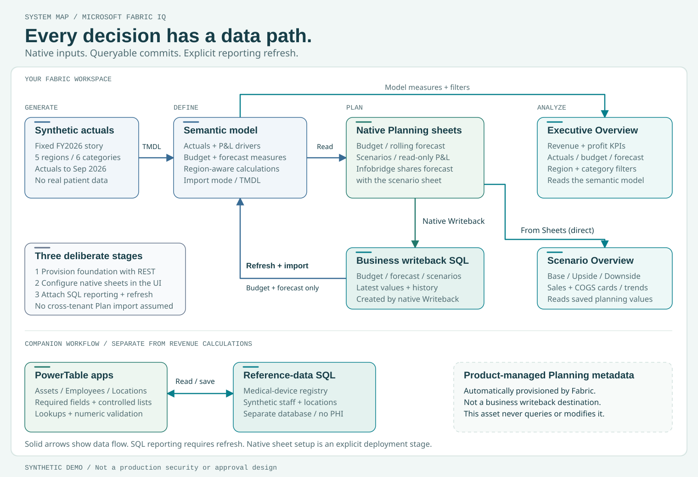

# Architecture

The diagram is generated offline by `python scripts/render_architecture.py`.
The [SVG](images/architecture.svg), [PNG](images/architecture.png) and
[editable Excalidraw source](images/architecture.excalidraw) contain no tenant identifiers.

## 1. Foundation and scope

One dedicated workspace contains two business Fabric SQL databases, the MedTech semantic model and its
Plan item. The official Microsoft FMCG sample model and an empty tutorial Plan item are retained as a
baseline, not a second fully configured nine-sheet demo. Fabric also provisions its own Planning metadata
database. That database is not one of the business writeback destinations and is never queried or edited here.

The default prefix is `FabricPlanningDemo`; the resource names are templates, not fixed tenant identities.
Workspace/model/database IDs and SQL endpoints are discovered and stored in the operator's local manifest.
No capacity is provisioned, resumed or resized by the asset.

## 2. Synthetic semantic foundation

The scenario represents fictional **Northwind MedTech & Life Sciences**, with six product categories
and five regions. Sales actuals run January 2023 through September 2026; FY2026 is the fixed plan year.
The generator contains 26,970 sales rows and 765 P&L driver rows.

Small dimensions use Power Query `#table`; larger facts use the compressed Enter Data representation.
This makes the foundation refresh independent of external business data and SQL writeback tables.
The model is Import mode and its source is TMDL, not a fabricated PBIX.

`Baseline Revenue` and `Baseline COGS` align prior-year values with plan-year periods.
Actuals and P&L drivers remain generated source data; planning writes do not update them.
Costs are positive, gross profit subtracts COGS, and ratios are recomputed at the current aggregation.
The model uses `DIVIDE` for zero-denominator handling. Amounts have no currency dimension; present them
as illustrative USD-like units without implying an implemented FX conversion.

## 3. Nine native sheets

| Sheet | Grain / purpose | Persistence or source |
|---|---|---|
| FY2026 Revenue Budget | Region > Category by Year > Quarter > Month | Budget writeback table |
| Rolling Forecast | Region by Year > Quarter > Month | Forecast writeback table |
| Scenario Comparison | Base/Upside/Downside sales and COGS; formula gross profit | Scenario writeback table; Infobridge forecast |
| Profitability P&L | Region > Year; gross-to-net and operating profit | Read-only P&L driver measures |
| Assets | Medical-device reference records | PowerTable SQL |
| Employees | Synthetic clinical-engineering staff | PowerTable SQL |
| Locations | Synthetic hospital locations | PowerTable SQL |
| Executive Overview | Four cards, four charts, Region/Category filters, commentary | Semantic model |
| Scenario Overview | Six cards, two monthly charts, commentary | Planning values through From Sheets |

The P&L All row covers all available years, not FY2026 only. Its driver-based gross/net revenue and
profit definitions should not be confused with the sales-fact YTD cards.

## 4. Native writeback

Planning creates the three `dbo.medtech_*_fy2026` tables on first native Writeback.
No guessed DDL is supplied. The **Long with Changes** destination stores aggregation nodes as well as
leaf values. Rolled-up dimensions contain `All`; history includes previous values and current-row flags.

Reporting and verification select `IsLatest = 1`, the intended series, and the correct leaf grain.
Summing the entire table would double-count aggregates and history.

The budget's leaf grain is Region x Category x Month; the forecast's is Region x Month.
Scenario values are isolated by `IrScenario`. The reference build writes Upside and Downside, not Base.
Longer sheet horizons can introduce NULL placeholder rows outside FY2026.

The native grid drives changes; T-SQL is used to observe them, not to simulate native writeback.
Snapshots/diffs assert the changed leaf and unchanged other leaves. Reconciliation queries check totals.

## 5. Reporting round trip

After both budget and forecast tables contain values, explicitly deploy with
`--update-medtech-model --include-writeback`. The stage checks real schema and committed rows before
replacing the owned generated model. Its previous definition is backed up under ignored `reports/`.

Two model tables import the latest budget/forecast leaves. Virtual relationships using `TREATAS` apply
Geography, Product and Date filters without joining `All` sentinel rows to dimensions.
The region-only forecast returns BLANK under a product-category filter rather than inventing an allocation.
Actual-vs-budget compares actuals with budget for the same populated months. Forecast-vs-budget compares
the plan-year forecast and budget.

SQL writeback is not instantly visible in the Import model. `refresh_model.py` binds a fresh short-lived
SQL OAuth credential, requests a model refresh and waits for the matching request ID.
`--verify` then reconciles DAX with SQL totals, regions, edited cells, variance and monthly series.
Finally refresh the Intelligence visuals. Schedules relying on an expired API-bound credential are not a
durable refresh strategy; production connection design is outside this demonstration.

## 6. Two distinct cross-sheet paths

**Infobridge:** a Planning Sheet query exposes `FY2026 Forecast` from Rolling Forecast to Scenario Comparison.
The shared dimensions match and the mapping is one-to-one. Initial source/destination values were compared
in the reference build. Automatic propagation after subsequent edits has not been proven.

**From Sheets:** Scenario Overview reads the scenario sheet's saved sales/COGS values directly.
It does not query the scenario SQL table through the semantic model. Cards and monthly series are bound;
the explanatory gross-profit commentary is static and must be updated if the scenario assumptions change.
Neither route should be described as a tested live event stream.

## 7. PowerTable companion

The workbook creates Assets, Employees and Locations tables. The native app supports grid/form entry,
lookups, required fields, a closed status list and numeric bounds. Its rules protect this app's inputs,
not arbitrary SQL writers: no corresponding database constraints or universal RLS are added by this repo.

This workflow illustrates clinical-engineering reference-data management. It has no implemented
dependency on the revenue forecast.

## 8. Save is not approval

| Action | Meaning |
|---|---|
| Save sheet/item | Persists native configuration and saved planning inputs |
| Collaboration connection | Supports native collaboration state; separate from business writeback |
| Writeback | Commits configured series to the business SQL table |
| Refresh model | Imports the committed budget/forecast values into reporting |
| Approval | A separate governance decision; not configured in this asset |

Multi-user enforcement, approvals, Optimizer/Cube, later horizon rollover and production authentication
are deliberately not claimed. See [security](security-and-permissions.md) and [validation status](deployment-status.md).
