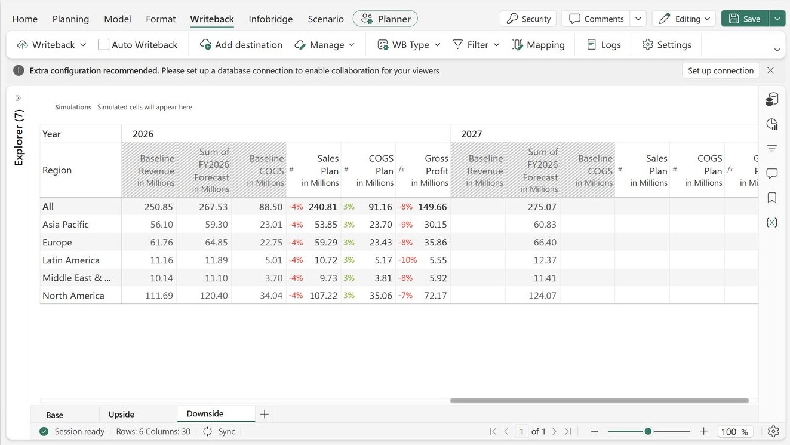
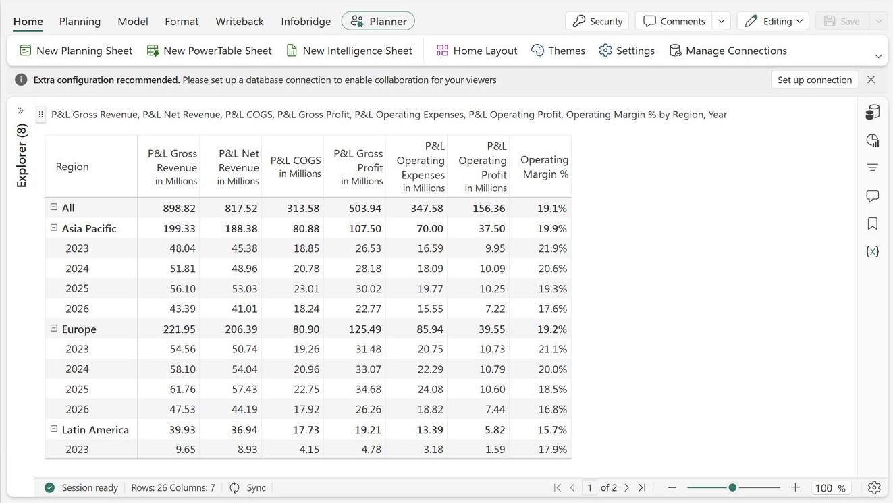
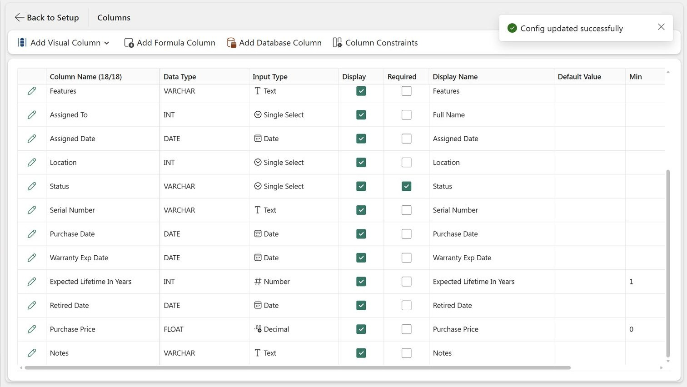
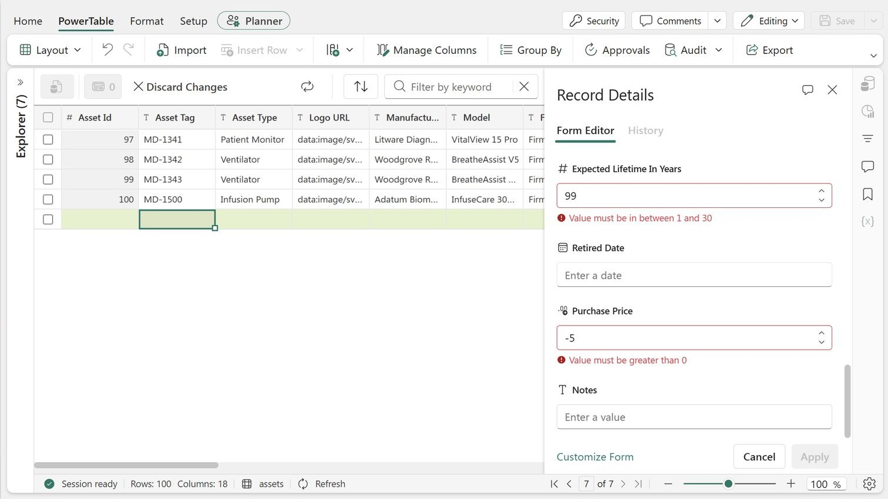
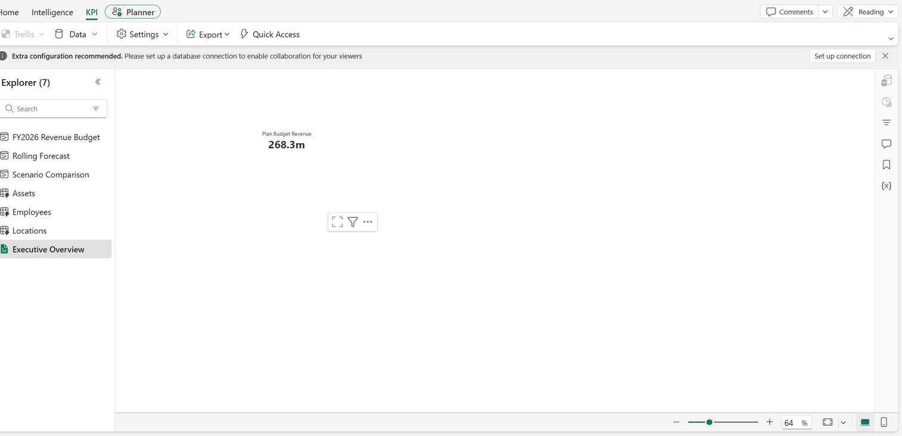
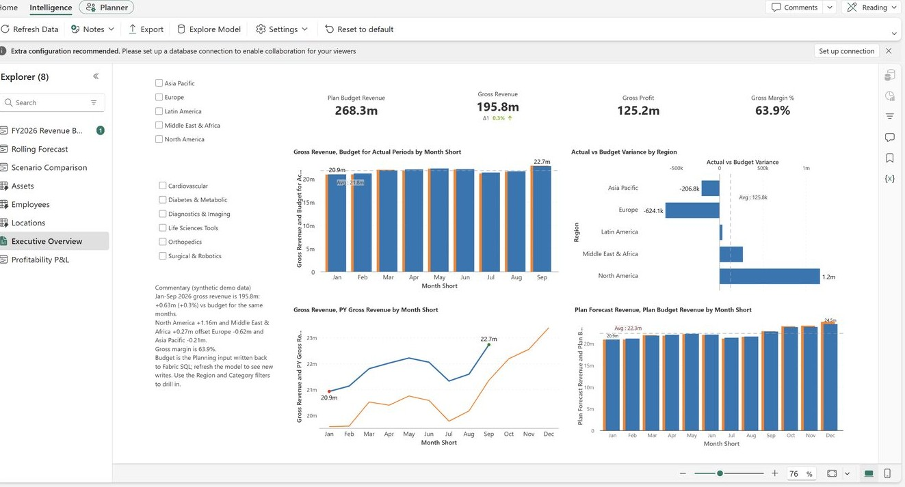
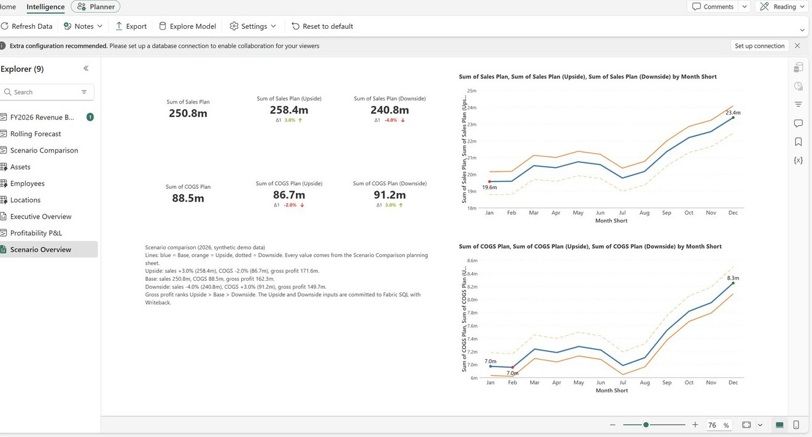
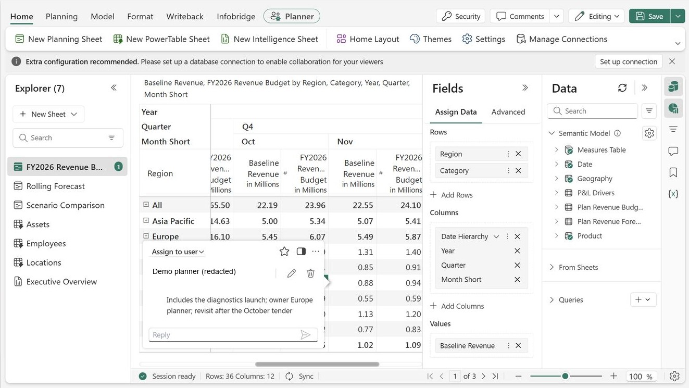

# Manual setup (native Planning UI)

This asset configures Planning sheets, formulas, forecasts, scenarios, destinations and PowerTable apps
through the **native Fabric UI**. Microsoft documents Plan item definitions, including per-sheet parts;
this repository does not implement a tested cross-tenant importer or a native Writeback trigger API.
These steps describe the reference build. Perform them in your tenant and collect new evidence using
[the deployment and proof guide](deployment-guide.md); the optional Playwright helpers are not a turnkey builder.

Prerequisites: the [README foundation stage](../README.md#3-provision-the-foundation) has created the workspace, both Fabric SQL databases, the MedTech semantic model
(refreshed, 26/26 DAX checks) and the empty Plan item `FabricPlanningDemo_MedTech_Plan`. You are signed in as a **native member**
account that can write to the workspace. Opening the plan and editing starts a 30-day **Planner session** (billing: see
[cost-and-cleanup.md](cost-and-cleanup.md)).

Amounts you type are **raw units** (type `268000000`, not `268`); the grid displays millions.
Resource names below use the default prefix; substitute your configured names if you changed it.
Screenshots are cropped reference illustrations, not a deployment template or proof of your own tenant.

## A. Connect the plan to the semantic model

1. Workspace `FabricPlanningDemo` > `FabricPlanningDemo_MedTech_Plan`.
2. Home > **Get data** > **Semantic model** > `FabricPlanningDemo_MedTech`. When asked for a connection, use (or create once) a
   **PowerBIDatasets** shared cloud connection with the signed-in organizational account. *The documentation calls the connection-based
   flow deprecated; in this tenant the connection was still required.*
3. New **Planning sheet**. In the Data pane, the model shows `Measures Table`, `Date`, `Geography`, `P&L Drivers`, `Product`.

## B. Sheet 1 - `FY2026 Revenue Budget`

1. Drag **Rows** = Region, then Category; **Columns** = Date Hierarchy (Year > Quarter > Month Short); **Values** = `Baseline Revenue`.
   Drops insert at the top of a zone, so add the lowest level first and the parent last.
2. Planning > Insert Column > Number > **Copy from another series** > `Baseline Revenue`; click the title editor (a CodeMirror box:
   select all, then type) and name it `FY2026 Revenue Budget`. **Save** the sheet.
3. On the **All** row, 2026, edit the new series to `268000000` and choose a distribution proportional to `Baseline Revenue`
   (prior-year mix). Europe / Diagnostics & Imaging / Oct becomes 922,743.48; edit it to 1,172,743.48 later for the writeback proof.

## C. Writeback of the budget (T-09)

1. Writeback tab > **WB Type** > **Long with Changes** *(set this first: changing the type clears selected destinations)*.
2. **Add destination** > create/select the Fabric SQL connection (**Organizational account**) > Database = `FabricPlanningDemo_Writeback` >
   table name `medtech_revenue_budget_fy2026` > Add.
3. **Settings > Destinations**: tick the table. **Settings > Data > Series allowed**: allow only `FY2026 Revenue Budget`.
4. Writeback > **Writeback** (current sheet). Planning creates the table on first run (648 rows for this sheet).
5. Before editing the leaf, run the complete registration and snapshot commands in
   [Budget proof](deployment-guide.md#budget-first-write-snapshot-edit-write-compare). Then edit, Save, Writeback and run the matching diff.

## D. Sheet 2 - `Rolling Forecast` (forecast through Dec 2027)

1. Rows = Region; Columns = Date Hierarchy; Values = `Gross Revenue`.
2. Model > **Forecast** wizard: *Basic* (name `FY2026 Forecast`) > *Closed periods* = **Link to measure** `Gross Revenue` > *Open periods* = **Data input**.
3. Period > **Close Period**: the closed-period boundary must be **September 2026** for this fixed story.
   The reference build used **Previous Quarter** while the calendar was in Q4 2026. Use that shortcut only if it still selects Sep 2026.
   Otherwise select the equivalent explicit period using the current native UI and inspect the preview; that later-date path was not exercised in the reference build.
   Tick **Extend Forecast Range** = **1 Year**; Preview > Save. Confirm periods extend through Dec 2027 rather than blindly following today's calendar.
   *The generic Period ribbon date-range picker hid the plan year in the reference build; validate the visible range before saving.*
4. Select the All row x a forecast cell > Model > **Predict** > Trend Decomposition (MSTL), Year + Quarter seasonality, 90 % interval >
   **Run Forecast** > **Save Forecast** > **Save**.
5. Optional: drag the budget series from **Data > From Sheets** next to the forecast to compare.

### D2. Writeback of the rolling forecast (T-14)

1. Writeback tab > **WB Type** > **Long with Changes** > **Add destination**. The dialog now pre-selects the only matching shared connection (`FabricSql FabricPlanningDemo admin`); choose
   **Database Item** `FabricPlanningDemo_Writeback`, schema `dbo`, table name `medtech_rolling_forecast_fy2026`, **Add** (the button spins while the name is validated; the dialog closes when the destination is registered).
2. **Settings > Destinations**: the new destination is already ticked. **Settings > Data**: allow only `FY2026 Forecast` (`Gross Revenue` and the budget series are excluded; the plan definition then lists their ids under `excludedMeasureGuids`). **Save**.
3. Writeback > **Writeback**. In this build the ribbon has one `Writeback` item that writes the sheet being shown (there is no *Writeback All* here). Planning creates the table: **516 nodes** = 6 region nodes (All + 5 regions) x 86 time nodes
   (1 total + 5 years + 20 quarters + 60 months); 300 of them are leaves (5 regions x 60 months). Closed periods hold the **actuals** (Jan-Sep 2026 = linked `Gross Revenue`), open periods the seasonal forecast.
   Use the complete [forecast registration and snapshot commands](deployment-guide.md#forecast-repeat-the-native-input-to-sql-proof) before editing.
4. Edit one open-period input: expand the column headers (**2026**, then **Q4**: the chevron left of the label) and set `Europe` / `Oct` / `FY2026 Forecast` from 5.66 to `6000000`. **Save**, then Writeback again.
5. Prove it with the matching diff in the proof guide. In the reference build exactly one leaf changed (5,662,104.37 -> 6,000,000.00); in the table the leaf and its
   7 ancestors (Europe Q4, Europe 2026, Europe All, All Oct, All Q4, All 2026, All All) each gained a new `IsLatest = 1` row (+337,895.63) and the old rows stayed as history (524 rows, 516 latest). The all-regions 2026 total moved from 267,531,575.09 to 267,869,470.72.
6. Reporting: add the table to `medtech.writeback_tables` (`role: forecast`, `dimensions: [Region]`, measure `Plan Forecast Revenue`) and run the model update from section F; T-10 then also reconciles the forecast and its variance to the budget (-380,529.29 for 2026) and the 12 monthly forecast and budget values that the Intelligence chart in section I plots.

## E. Sheet 3 - `Scenario Comparison` (T-06)

1. Rows = Region; Columns = Date Hierarchy; Values = `Baseline Revenue`, `Baseline COGS`; add two **Number > Copy from another series** columns
   `Sales Plan` (from Baseline Revenue) and `COGS Plan` (from Baseline COGS).
2. Planning > Insert Column > **Formula**: title `Gross Profit`; in the formula box type `Sa` and press **Enter** to accept the suggestion `[Sales Plan]`,
   type ` - `, then `Pla` and press **Enter** (first suggestion is `[COGS Plan]`). Create. *Typing the brackets by hand fails to parse;
   references must come from the suggestion list, and the suggestion filter works on the last word only.*
3. Model > **Scenario** > name `Upside`, keep the series chips `Sales Plan` and `COGS Plan` (remove the other three chips with their x) > Create. A **Scenario** ribbon tab and bottom
   tabs **Base | Upside** appear. **Save** (cells can only be edited on a saved sheet). (A formula column added before or after the scenario - here `Gross Profit` - is picked up automatically:
   the sheet note lists the series that can be simulated.)
4. In **Upside**, All row of the 2026 group: `Sales Plan` = `258373470` (+3 %) and `COGS Plan` = `86733589` (-2 %). Gross Profit shows 171.64 vs 162.34 in Base (+9.30).
5. Writeback destination `medtech_scenario_plan_fy2026` (type *Long with Changes*, series allowed `Sales Plan`, `COGS Plan`), Save, **Writeback**. Writeback stores the changed cells of the **active** tab only.
6. Second scenario: Model > **Scenario** (or the **+** at the end of the tab strip) > name `Downside`, the same two chips > Create > **Save**; in the All row of 2026 type `Sales Plan` = `240814108` (-4 %) and `COGS Plan` = `91158772` (+3 %).
   Gross Profit shows 149.66 (-8 %, -12.69 vs Base) and the five regions follow proportionally (Europe 59.29 / 23.43, North America 107.22 / 35.06, ...). With **Downside** active run **Writeback** once more.
   Verify with `python scripts/validate.py run --only T-06`: Upside 171.64 > Base 162.34 > Downside 149.66 (gross profit, millions). T-12 checks that no registered writeback table has duplicate latest grains.



Practical notes: the 2026 columns are the fourth group of five years (2023-2027) after Infobridge widened the sheet (section H), so scroll the grid right before typing (`div.scrollable-grid`, or collapse the Explorer / Fields / Data panes);
collapse the panes with their chevrons for a clean screenshot. Because the sheet spans five years, the Downside writeback also stored **NULL placeholder rows** for 2023-2025 and 2027 (816 of its 1,032 rows: the Upside, written
when the sheet only had 2026, stored 216). They carry no number and are ignored by T-06, which reads the plan year only, and by the model (the scenario table is not surfaced in it); filter `Value IS NOT NULL` when querying the table by hand.

## E2. Sheet 4 - `Profitability P&L`

A profit view over the driver-based `P&L Drivers` table (actuals Jan 2023 - Sep 2026), so the demo shows a P&L from the same model that the planning sheets use.

1. Home > **New Planning Sheet** > name `Profitability P&L` > Create (an empty sheet: *Assign Data to Start Planning*).
2. Fields pane: **Rows** = `Region` (Geography) then `Year` (Date); no Columns; **Values** = `P&L Gross Revenue`, `P&L Net Revenue`, `P&L COGS`, `P&L Gross Profit`, `P&L Operating Expenses`, `P&L Operating Profit`, `Operating Margin %` (all in `Measures Table`).
   *Order matters: a field dropped on the centre of a long well lands in the middle of it, so add the measures one at a time in the final order and read the well afterwards (`PlanUI.drag_field(..., position="bottom")` appends).
   Pick the item whose label is exactly `Year`: the search also lists `Half Year`, `Year Month` and `Year Quarter`.*
3. **Save**.
4. Check against the model: the All row shows 898.82 gross revenue, 817.52 net revenue, 313.58 COGS, 503.94 gross profit, 347.58 operating expenses, 156.36 operating profit and a 19.1 % operating margin (millions);
   net revenue - COGS = gross profit and gross profit - operating expenses = operating profit. The same totals are asserted by the model check (`PnlGrossAll` ... `PnlOperatingAll` in `scripts/lib/medtech_checks.py`,
   tied to `model/medtech/expected-totals.json`) and the sheet is part of T-05.



The sheet is a read view with no writeback destination (the P&L actuals are not planned here). 2026 holds January-September actuals only, which is why its rows are smaller than the full years.

## F. Reporting round trip (T-10)

The **Add table to semantic model** option was not present in the reference tenant's Writeback ribbon. After both tables contain committed values, use:

```powershell
python scripts\deploy.py plan --only medtech_model --update-medtech-model --include-writeback
python scripts\deploy.py apply --confirm-tenant "YOUR-TENANT-GUID" --confirm-workspace "FabricPlanningDemo" `
  --only medtech_model --update-medtech-model --include-writeback
```

Use your configured capacity in `.env` and replace the tenant/workspace confirmation values.
(adds the `Plan Revenue Budget` table and the measure `Plan Budget Revenue`, binds an OAuth2 token to the SQL source, refreshes). Then
`python scripts/validate.py run --only T-10` must report that the measure equals T-SQL in total, for every region and for the edited leaf.
Remember: Import mode shows writes only after refresh. After later writes run `python scripts/refresh_model.py`
(add `--verify` for SQL/DAX reconciliation). API-bound credentials are short-lived, so ordinary portal/scheduled
refresh can fail after expiry. Completion time and token lifetime depend on your environment.

## G. PowerTable sheets (T-07)

1. Explorer > **New Sheet** > **PowerTable** > name it (a name that already exists as a sheet is rejected later) > **Create a New App**.
2. **Select Fabric SQL Connection**: the existing Fabric SQL connection > **Database Item** > `FabricPlanningDemo_PowerTable` > **Connect**.
3. **Select Table**: **New Table**, schema `dbo`, table name `assets`, **Upload File**, Import Type **Excel**, upload
   `model/medtech/Northwind-MedTech-asset-registry.xlsx` (regenerate with `python scripts/medtech_assets.py build`).
4. **Preview Data**: set Source Table Name to lowercase `assets`, `employees`, `locations`; keep the default sheet names (`Assets`, `Employees`, `Locations`);
   **clear** the `Import` tab (used later for the optional import step). A red warning on a tab means a sheet-name clash.
5. **Configure Table**: tick **Identity Column** for `Asset Id`, `Employee Id`, `Location Id`; raise the `Logo URL` **Length** to 1000 (the import sheet's logos are longer
   than the auto-detected 322). Finish > Done. T-SQL now shows `dbo.assets` 99, `employees` 30, `locations` 33 rows.
6. Edit: the grid is a canvas (Glide Data Grid). Click a cell, move with the arrow keys, **Enter**, type, **Enter**; then **Save to Database** > **Proceed**
   ("Data saved successfully"). Insert: PowerTable > Insert Row dropdown > **Insert Using Form By Default**, **Insert Row**, fill the form (dates must be picked from the calendar), **Apply**, **Save to Database**.
7. Use the exact before/edit/after commands in [PowerTable proof](deployment-guide.md#powertable-capture-before-editing).

### G2. Column rules: required fields, closed list, lookups, bounds (T-15)

The tutorial import creates plain text/number columns; the rules are set afterwards on the `Assets` sheet (Setup tab > **Columns** opens the *Columns* page with one row per column and an **Edit** pencil).

1. **Required**: tick the **Required** checkbox of `Asset Tag` and `Status` (the key `Asset Id` is already required and locked). The page answers *Config updated successfully*.
2. **Closed value list**: **Edit** `Status` > Input Type **Single Select** > Values Type **Distinct Values** (the options come from the stored values: Available, In Service, Under Maintenance, Retired) and leave **Allow Adding New Options** unticked > **Save**.
3. **Lookups**: **Edit** `Assigned To` > Input Type **Single Select** > Values Type **Lookup** > Lookup Table `employees`, Lookup Key Column `Employee Id`, Lookup Display Column `Full Name` > **Save**; repeat for `Location` with `locations`, `Location Id`, `Location`.
   (The two dependent drop-downs of a lookup are the 5th and 6th combo boxes of the pane; the display column list offers every column, the key list only the integer ones. The form then labels the field with the display column's name.)
4. **Bounds**: **Edit** `Expected Lifetime In Years` > Minimum `1`, Maximum `30`; **Edit** `Purchase Price` > Minimum `0`, untick **Allow Negative Numbers** > **Save** each. **Back to Setup**, then the ribbon **Save**.
5. Enforcement in the record form (**Insert Row**): `Asset Tag *` and `Status *` are marked and **Apply** stays disabled until both are filled; a lifetime of `99` shows *Value must be in between 1 and 30* and a price of `-5` shows *Value must be greater than 0*.
   Cancel the form and **Discard Changes**: nothing is written (`dbo.assets` keeps its 100 rows).
6. Prove it: `python scripts/validate.py run --only T-15` reads the saved column configuration from the plan definition (`mandatory`, `columnType` 2 = single select, `selectionMethod`, `lookupConfig`, `min` / `max`) and counts stored rows that violate a rule with read-only T-SQL.




Not configured: PowerTable **Approvals**, **Automations**, **Forms** and **Manage Access** (no approval request or notification was sent). The **Add Comment** command is greyed out on a PowerTable sheet in this build; comments are made on planning-sheet cells (section J).

## H. Infobridge - share a measure between sheets (T-08)

Infobridge (the *connected planning* engine) exposes a sheet's measures as **queries** that other sheets can use. The documented share-measure flow needs two planning
sheets with **identical row and column dimensions**: `Rolling Forecast` and `Scenario Comparison` both use Region x Year > Quarter > Month.

1. Open `Scenario Comparison`. In the **Data** pane expand **Queries** > **Add** > **Planning Sheet**.
2. In **Add Query**, set **Sheet** to `Rolling Forecast`, clear **All**, tick only the measure `FY2026 Forecast`, **Add**. Infobridge opens, loads the query
   (`Query 1 - Rolling Forecast`, 300 rows) and shows a green *Last Run*; review the preview, then click **Close**.
3. Under **Queries** the measure appears; **drag it once** into **Values** (the grid shows `Sum of FY2026 Forecast`; repeated drags add duplicates - remove extras with their **x**).
4. **Save**. Compare with the source: 2026 All **267.53**, Asia Pacific 59.30, Europe 64.85, Latin America 11.89, Middle East & Africa 11.10, North America 120.40 (USD millions) - identical in both sheets,
   as are 2023 (218.36), 2024 (233.80) and 2027 (275.07). The measure spans all years because the forecast measure does, so the sheet widens to 30 columns; scroll to 2026.
5. Verify structurally with `python scripts/validate.py run --only T-08` (reads the plan definition: the Infobridge source/query and the consumer sheet's reference).

**The flow in one table**

| Aspect | This build |
| --- | --- |
| Source | planning sheet `Rolling Forecast`, measure `FY2026 Forecast` (an Infobridge *Planning Sheet* source; query `Query 1 - Rolling Forecast`, 300 records) |
| Destination | planning sheet `Scenario Comparison`, Values well (`Sum of FY2026 Forecast`) |
| Mapping | one-to-one on the shared dimensions Region x Year > Quarter > Month; the documented requirement for sharing a measure is identical row and column dimensions on both sheets |
| Transformation | none: the measure is passed through unchanged (no custom ETL, no calculated column) |
| Refresh / execution | the query ran when it was added (Infobridge showed a green *Last Run*) and the destination reads it when the sheet loads. **Not tested:** whether editing a source forecast cell re-runs the query automatically; re-open the sheet and compare before a demo that edits the source |
| Success check | values equal the source cell for cell (2026 All 267.53; Europe 64.85; ...), and the plan definition lists the query and the consuming sheet (T-08) |

## I. Intelligence sheet - `Executive Overview`

An Intelligence sheet is a report canvas (Analytics+ visuals) over the plan's semantic model, so everything on it reads the same `FabricPlanningDemo_MedTech` measures as the planning sheets and the DAX checks.

1. Explorer > **New Sheet** > **Intelligence** > name it `Executive Overview`. Open the **Visualizations** and **Data** panes (right strip). Work in **Editing** mode.
2. **Page filter**: Filters pane > *Filters on this page* > drag `Year` (Date) in and tick **2026**; every visual below then shows the plan year.
3. **KPI cards** (Visualizations > **KPIs** > **Card**; then in the **Data** pane search a measure and drag it into **Actual(s)** with real mouse down / move / up events - `drag_to` is unreliable here, see `PlanUI.drag_to_named_well`):
   `Plan Budget Revenue`; `Gross Revenue` with **Comparison 1 (vs Actuals)** = `Budget for Actual Periods` (shows the delta, +0.3 %); `Gross Profit`; `Gross Margin %`.
4. **Charts** (Visualizations > **Charts 100+**; group, then variant): *Overlapped column* with **Category** = `Month Short` (Date), **Actual(s)** = `Gross Revenue`, **Comparison 1** = `Budget for Actual Periods`;
   *Overlapped bar* with **Category** = `Region` (Geography), **Actual(s)** = `Actual vs Budget Variance`; *Line* with **Category** = `Month Short`, **Actual(s)** = `Gross Revenue`, **Comparison 1** = `PY Gross Revenue`;
   and a second *Overlapped column* with **Category** = `Month Short`, **Actual(s)** = `Plan Forecast Revenue`, **Comparison 1** = `Plan Budget Revenue` (the rolling forecast against the budget for every month of the plan year).
   Check each chart's contextual ribbon > **Themes**: **Default Theme** must be the ticked one (see the black-chart gotcha below).
5. **Filters**: Visualizations > **Super Filter** twice: **Category** = `Region` (Geography) and **Category** = `Category` (Product; the *second* `Category` in the search results - the first is a column of the written-back budget table).
6. **Commentary**: Intelligence tab > **Elements** > **Text**, click into the element and type. The text is static; re-read it whenever the data changes.
7. **Layout**: Intelligence tab > **Layout** opens the Layout pane (it is only offered while no visual is selected). Select an element and set *Dimension & Position* in percent of the page (whole numbers; size first, then position).
   New visuals are dropped on a grid of 30 % x 40 % tiles (and wrap onto the first tile after six), so overlap is the default: place them explicitly.

| Element | x, y, width x height (%) | Reconciles to |
| --- | --- | --- |
| Super Filter `Region` | 1, 2, 18 x 24 | - |
| Super Filter `Category` | 1, 28, 18 x 24 | - |
| Commentary text | 1, 54, 18 x 44 | the variance by region below (2026 Jan-Sep: North America +1.16m, Middle East & Africa +0.27m, Europe -0.62m, Asia Pacific -0.21m) |
| KPI `Plan Budget Revenue` | 21, 2, 19 x 16 | T-10 total 268,250,000.01 -> **268.3m** |
| KPI `Gross Revenue` (+ delta) | 41, 2, 19 x 16 | actuals Jan-Sep 2026 195,831,920 -> **195.8m**, +0.3 % vs the budget of the same months |
| KPI `Gross Profit` | 61, 2, 19 x 16 | 125.2m |
| KPI `Gross Margin %` | 80, 2, 19 x 16 | 63.9 % |
| Overlapped column, Gross Revenue vs Budget for Actual Periods by month | 21, 20, 39 x 38 | the budget for the months that have actuals (like-for-like) |
| Overlapped bar, Actual vs Budget Variance by region | 61, 20, 39 x 38 | T-10 variance by region (total +629,080.40) |
| Line, Gross Revenue vs PY Gross Revenue by month | 21, 60, 39 x 38 | prior-year actuals |
| Overlapped column, Plan Forecast Revenue vs Plan Budget Revenue by month | 61, 60, 39 x 38 | the 12 monthly values equal SQL (T-10, 24/24); year totals 267.87 M forecast against 268.25 M budget (-0.38 M) |

8. Intelligence tab > **Refresh Data** (visuals do not query until this is pressed after their wells change) and **Save after every visual**: an unsaved Intelligence draft is discarded when the page reloads.
   The sheet is persisted in the plan definition (`sheets/<sheet id>/visuals/<visual id>/properties.json`); `python scripts/validate.py run --only T-05` reports how many saved visuals are bound to `Plan Budget Revenue`.





Reader check (2026-10-23, Reading mode, page filter Year = 2026): the four cards equal DAX over the model for the unfiltered page (268.3m / 195.8m / 125.2m / 63.9 %), for **Region = Europe** (66.2m / 47.5m / 29.6m / 62.3 %) and for
**Europe + Diagnostics & Imaging** (10.9m / 7.6m / 3.9m / 51.5 %), and return to the totals when the filters are cleared.

Gotchas observed while building the page:

- **Selection by clicking is not reliable.** A visual that was moved leaves its old frame behind and the click lands on whatever is on top. Check the box shown in the Layout pane before editing it (`PlanUI.select_visual(..., expect=(x, y, w, h))`
  tries click points until the pane shows the expected box) or select from the **Canvas** pane's *Layers* list.
- **The ribbon changes with the selection** (contextual KPI / Overlapped column / Super Filter / Text tabs hide the Intelligence tab's items): click the **Intelligence** tab again to reach **Refresh Data**, **Layout** and **Elements**.
- The **Super Filter** is drawn by the report frame, not an iframe; its wells are *Category* (one field) and *Others*.
- **Capacity throttling can look like a product error.** In the reference capacity's delay stage cards alternated between values and *Something went wrong - Internal Server Error*. Investigate the actual error rather than assuming every failure has this cause. The error is a modal
  rendered by the Fabric shell that blocks all clicks and hides the ribbon from the accessibility tree until it is closed (`PlanUI.dismiss_error_dialog()`). Earlier failed attempts with comparison wells and charts were this, not a limit of the wells:
  once the capacity had rested, the comparison card and all four charts rendered and saved.
- **A chart created while the capacity was throttled comes out black.** The forecast-vs-budget chart was added during a throttled spell and never painted then. When the page first rendered on a healthy capacity its forecast and budget columns were both black and could
  not be told apart. Its saved properties held 360 values against about 2,000 for the first chart (no appearance state), and the chart's contextual ribbon > **Themes** showed *Customize* ticked. Fix: Editing mode > select the chart > **Themes** > **Default Theme** > **Save**
  (the columns became blue and orange like the first chart; saving also re-serialised the other visuals' hidden state and the Super Filters' field bindings, which is harmless). Checked after a reload in Reading mode (the screenshot above).
- After a model update use the **refresh icon of the Data pane** before searching for new measures or tables; a fresh page load can lag the model by a minute.

## I2. Intelligence sheet - `Scenario Overview` (scenario comparison)

The brief asks for a scenario comparison in Intelligence. The scenario writeback table is not part of the semantic model (and does not need to be): an Intelligence sheet can read the **planning sheet's own data** through the Data pane's **From Sheets** section, which lists every planning sheet of the plan.
Under `Scenario Comparison` it offers `Sales Plan`, `COGS Plan`, `Gross Profit` and the `Sales Plan (Upside)`, `COGS Plan (Upside)`, `Sales Plan (Downside)`, `COGS Plan (Downside)` variants. Building the page changes nothing in the model and involves no refresh.

1. Editing mode > **Home** tab > **New Intelligence Sheet** (answer the *Confirm Action* prompt with **Discard and Proceed** when nothing is pending), name it `Scenario Overview` > **Create**.
2. **KPI cards** (Visualizations > **KPIs**): drag a field from **Data > From Sheets > Scenario Comparison** into **Actual(s)** (search for its name; it behaves like a model field) and put the Base measure (`Sales Plan` / `COGS Plan`) into **Comparison 1 (vs Actuals)** so that the card shows the delta against Base:
   Upside sales 258.4m (+3.0 %), Downside sales 240.8m (-4.0 %), Upside COGS 86.7m (-2.0 %), Downside COGS 91.2m (+3.0 %); plus two Base cards, Sales Plan 250.8m and COGS Plan 88.5m, without a comparison. The wells show them as `Sum of Sales Plan (Upside)` and so on.
3. **Charts** (Visualizations > **Charts 100+** > **Line**): **Category** = `Month Short` (Date), **Actual(s)** = `Sales Plan`, **Comparison 1** = `Sales Plan (Upside)`, **Comparison 2** = `Sales Plan (Downside)`; a second line chart the same way for `COGS Plan`. The lines are Base (blue), Upside (orange) and Downside (dotted).
4. **Commentary**: Intelligence tab > **Elements** (its drop-down is drawn in an overlay: *Text, Shapes, Buttons, Grid layout, Image*) > **Text**, click into the element and type the legend, the deltas and the gross profit per scenario. The sheet has no scenario variants of *Gross Profit*, so it is stated as text, like the commentary of the Executive Overview.
5. **Layout** (percent of the 16:9 page; Intelligence tab > **Layout**, then select each element: size first, then position). Save after the last element.

| Element | x, y, width x height (%) | Reconciles to (T-06) |
| --- | --- | --- |
| Card `Sales Plan` (Base) | 2, 3, 15 x 22 | 250,848,029 -> **250.8m** |
| Card `Sales Plan (Upside)` | 18, 3, 15 x 22 | 258,373,470 -> **258.4m**, +3.0 % |
| Card `Sales Plan (Downside)` | 34, 3, 15 x 22 | 240,814,108 -> **240.8m**, -4.0 % |
| Card `COGS Plan` (Base) | 2, 27, 15 x 22 | 88,503,662 -> **88.5m** |
| Card `COGS Plan (Upside)` | 18, 27, 15 x 22 | 86,733,589 -> **86.7m**, -2.0 % |
| Card `COGS Plan (Downside)` | 34, 27, 15 x 22 | 91,158,772 -> **91.2m**, +3.0 % |
| Line chart, Sales Plan by scenario by month | 52, 3, 46 x 45 | the same three totals, by month (12 months) |
| Line chart, COGS Plan by scenario by month | 52, 51, 46 x 45 | the same three totals, by month (12 months) |
| Commentary text | 2, 51, 46 x 44 | gross profit 171,639,881 / 162,344,367 / 149,655,336 -> 171.6m / 162.3m / 149.7m |

6. Reload the plan and open the sheet in Reading mode: the eight visuals and the text paint within about 30 s on a healthy capacity.



Gotchas observed while building this page:

- **From Sheets fields work like model fields.** `PlanUI.build_visual` needs no change: `build_visual("KPIs", actual="Sales Plan (Upside)", comparisons=("Sales Plan",))`. The saved visuals refer to them by internal ids (scenario id + measure id), so renaming or rebuilding the planning sheet's columns would break them.
- **The Layout pane is a toggle, and it shares the right-hand side with the Canvas pane.** Clicking the Intelligence tab's **Layout** item on an open pane closes it; `PlanUI.open_layout_pane()` only opens. Check that the pane shows values for a selected element before calling it again.
  The Canvas pane's *Layers* list selects elements by name (`Card`, `Card 1`, ..., `Line`, `Line 1`) but has no dimensions.
- **Placing overlapping visuals.** New visuals land on 30 % x 40 % tiles, later ones on top; a visual that is moved onto the tile of one that has not been placed yet makes that one unclickable. Place the ones whose tiles stay free first (or park the big ones), and confirm each selection from the box the Layout pane shows
  (the helper compares it with the frame geometry).
- **Height is clamped to the room below the position.** A chart parked at y = 82 % keeps an 18 % height after it is moved up: set the height again.
- In Editing mode every switch of sheet (and *New Intelligence Sheet*) asks **Confirm Action** even when nothing was edited; with nothing pending **Discard and Proceed** loses nothing.

## J. Comments on a planning cell (T-16)

1. Open `FY2026 Revenue Budget` in **Editing** mode, scroll to Q4 > Oct and **left-click** the `FY2026 Revenue Budget` cell of Europe / Diagnostics & Imaging (1.17). *A right-click shows no menu in this build.*
2. Top bar > **Comments** drop-down (the chevron next to the button) > **Add Comment**. The editor offers **Assign to user** (leave it empty), a pin, rich text and a send button that stays grey until there is text.
3. Type the text - *Includes the diagnostics launch; owner Europe planner; revisit after the October tender* - **without any @ (a mention notifies the person by Teams or e-mail)** and send. A toast says *Comment added successfully*,
   the cell gets a corner marker and the Explorer shows a count badge on the sheet. (The popup's DOM is not exposed to Playwright: type into the focused editor with the keyboard and click the send button by its screen position.)
4. **Save**, then Writeback > **Writeback**: comments are persisted by writeback. The cell's latest row gets the comment in `IrComments`; nothing was edited, so the value equals `PreviousValue` and exactly one row is added
   (661 rows; the cell's older row is superseded):
   `[{"comment":"Includes the diagnostics launch; ...","updatedByUser":"<author>","dateTime":"2026-10-23 07:57:20 (UTC)","threadStatus":10,"threadAssignee":null}]`
5. Verify with `python scripts/validate.py run --only T-16` (read-only): the comment is on the intended cell, the value did not move, and no thread in the table has an assignee or an @mention.



Not demonstrated: replies, assigning a thread, resolving or locking it, and anything that sends a notification. **Add Comment** is greyed out on PowerTable sheets in this build. The three `wb_comment_*` tables of the writeback database stayed empty;
the comment lives in `IrComments` of the data table.

## K. Not executed in this build

PowerTable approvals/automations/column access, comments on PowerTable cells, Intelligence features beyond the two pages built here (trellis, bookmarks, sharing), and multi-user role validation (T-11) are documented in
`docs/sources.md` and appear as `not_executed` in [deployment-status.md](deployment-status.md) unless that page says otherwise.

## Discrepancies and gotchas found while building

| Topic | What the docs suggest | What happened / what to do |
| --- | --- | --- |
| Semantic-model connection | direct, identity-based; connection flow deprecated | a shared PowerBIDatasets connection was still required |
| "Add table to semantic model" | documented writeback option | not exposed in the Writeback ribbon; TMDL table + OAuth binding used instead |
| Viewer collaboration banner ("set up a database connection") | needed for viewers | remained visible in the author-only reference demo; configure and permission a viewer connection explicitly before claiming multi-user collaboration |
| Title / formula inputs | text boxes | CodeMirror editors: select all and type; `fill` appends to the default text |
| Formula references | type `[Name]` | only suggestion-inserted references parse |
| Editing cells | edit in place | sheet must be saved first ("Please save your changes to edit this cell"); never type into row-label cells (renames a member) |
| Switching sheets with unsaved work | n/a | "Confirm Action" dialog: **Save and Proceed** |
| Writeback type | choose any time | changing it clears the selected destinations; set the type first, then tick the destination |
| Scenario writeback | all scenarios | only changed cells of the active scenario are written (Base stays implicit) |
| Period ribbon date range | usable | easily selects a wrong range (hid 2026); use **Close Period** |
| PowerTable sheet names | free | duplicates of existing sheets are rejected in the wizard |
| PowerTable grid | table | canvas grid: use clicks + keyboard; text and date inputs differ (date = calendar only) |
| Data pane | live | caches the model schema; use the refresh icon after a model update |
| Infobridge query fields | drag to Values | one drag is enough; repeated drags add duplicate `Sum of ...` wells (remove extras with their **x**) |
| T-SQL login | completes within the driver's 15 s default | the first login to an idle / throttled Fabric SQL database took 22 s; a `Connection Timeout` keyword in the ODBC connection string is ignored - pass the login timeout as the connection attribute (`pyodbc.connect(..., timeout=90)`, done in `sqlclient.connect`) |
| Capacity throttling | not mentioned in the Planning tutorials | a burst of automation on the `FTL4` trial capacity added a fixed 20 s to every interactive request (DAX, SQL login, Intelligence queries); wait it out or use a larger capacity (see `docs/cost-and-cleanup.md`) |
| "Something went wrong" modal in the plan | transient | rendered by the Fabric shell (top-level frame) with a dark backdrop: it blocks every click and hides the ribbon from the accessibility tree until closed (`PlanUI.dismiss_error_dialog()`); its details contain IDs only, no stack trace |
| Playwright screenshots | n/a | hang when the plan tab is not the active Edge tab; `PlanUI.attach` brings the tab to the front |
| Plan opens in **Reading** mode; switching to **Editing** blanks the page | choose Editing in the top-right drop-down | a plan always reopens in Reading. With a stale cached Microsoft Graph token (the portal reuses it for up to 24 h; Conditional Access changes make Graph answer it with 401 `TokenCreatedWithOutdatedPolicies`, a continuous-access-evaluation challenge) the Planning app never learns the current user and throws `Cannot read properties of undefined (reading 'id')` while it draws the editing toolbar: the plan area turns white and a reload returns to Reading. Fix without a new sign-in: `scripts.ui.session.drop_cached_graph_token(page)` (deletes that one MSAL cache entry of the tab by its key name), then `PlanUI.open_plan(url)` and `PlanUI.set_mode("Editing")`, which answers the *retain properties* prompt with **Discard and Proceed** |
| Right-click on a cell | context menu | no menu in this build (planning and PowerTable sheets): select the cell and use the top-bar **Comments** drop-down |
| Data pane search on the Intelligence canvas | results list below the box | after fields were used on another sheet a **Recent** popup covers the list; press Escape after typing (`PlanUI.search` does) |
| Long **Values** well | dropped fields keep their order | a field dropped on the centre of the well lands in the middle: append with `PlanUI.drag_field(..., position="bottom")` and read the well afterwards; the search for `Year` also offers `Half Year`, `Year Month` and `Year Quarter` |
| Writeback of a sheet that spans years without plan values | only changed cells | the Downside writeback also stored 816 NULL placeholder rows for 2023-2025 and 2027; harmless (T-06 reads the plan year), filter `Value IS NOT NULL` by hand |
| Comments | stored with the plan | persisted by **Writeback** in the `IrComments` column of the cell's row (a comment-only writeback adds one row with `Value` = `PreviousValue`); the `wb_comment_*` tables stayed empty |

## Replaying with the Playwright helpers

```powershell
python -m scripts.ui.session launch        # dedicated Edge profile (outside the repo), local-only debug port 9333
# sign in once in that window, open the plan (one tab only), then (PowerShell here-string piped to python):
@'
from scripts.ui.session import attached, drop_cached_graph_token
from scripts.ui.planning import PlanUI
PLAN_URL = "https://app.fabric.microsoft.com/groups/<workspace-id>/plans/<plan-id>?experience=power-bi"
with attached() as (browser, ctx):
    ui = PlanUI(ctx.pages[0])
    ui.page.bring_to_front()          # screenshots hang on a background tab
    ui.open_plan(PLAN_URL)            # a plan always opens in Reading mode
    ui.set_mode("Editing")            # if the page goes blank: drop_cached_graph_token(ui.page), open_plan again, retry
    # section D2: writeback destination for the rolling forecast (the dialog pre-selects the shared connection), then commit
    ui.configure_writeback("medtech_rolling_forecast_fy2026", "FabricPlanningDemo_Writeback", "FabricSql FabricPlanningDemo", ["FY2026 Forecast"])
    ui.save()
    ui.run_writeback()
    # edit one open-period input: expand 2026 > Q4, find the Oct column of the second measure (3 measures per month) in the Europe row
    ui.expand_column("2026"); ui.expand_column("Q4")
    row = ui.find_row("Europe")
    ui.enter_value(row, ui.column_index(row, "Oct", position=1, of=3), "6000000")
    ui.save()
    ui.run_writeback()
'@ | python -
```

`PlanUI.configure_writeback` = `add_destination` + `limit_writeback_series`; the pieces can be called separately when a step has already been done by hand. Intelligence helpers: `build_visual`, `set_layout`,
`select_visual(expect=...)`, `drag_to_named_well`, `refresh_report_data`, `dismiss_error_dialog`. `PlanUI.doc_image(name)` saves the current page as a scaled JPEG in `docs/images/` (needs Pillow).
The helpers never read or store token values. Close the Edge window when finished. Expect selector drift when the product UI changes.
